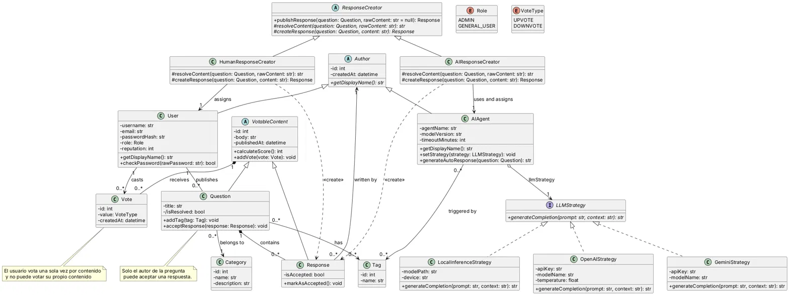

# Proyecto-IS

### Abstracción de autoría y Factory Method

`Response` depende de la clase abstracta `Author` y no de `User` ni de `AIAgent`. Gracias al polimorfismo, una respuesta se atribuye de la misma forma a una persona o a un agente de IA, sin duplicar lógica ni acoplar la entidad a un tipo concreto.

Lo que cambia entre ambos casos no es la clase `Response`, sino cómo se construye: de dónde sale el contenido y qué autor se asigna. Esa variación se encapsula con Factory Method: `ResponseCreator` define un único flujo de publicación y delega en `HumanResponseCreator` y `AIResponseCreator` los pasos que difieren. Agregar un nuevo tipo de autor implica agregar una subclase de `Author` y una de `ResponseCreator`, sin modificar el código existente.

### Strategy

`AIAgent` genera respuestas automáticas con un LLM, pero el proveedor puede variar (OpenAI, Gemini, un modelo local). Con Strategy, `AIAgent` depende solo de la interfaz `LLMStrategy`, y cada proveedor es una estrategia concreta que la implementa y encapsula sus propios detalles (credenciales, modelo, parámetros).

Cambiar de proveedor es llamar a `setStrategy(...)`, incluso en tiempo de ejecución, y sumar uno nuevo es crear una clase más. Así, la integración con los LLM queda intercambiable y desacoplada del dominio: `AIAgent`, `Response`, `Question` y el resto del sistema no se enteran del cambio.

Explicación completa: [docs/explicacion_uml.md](docs/explicacion_uml.md)
